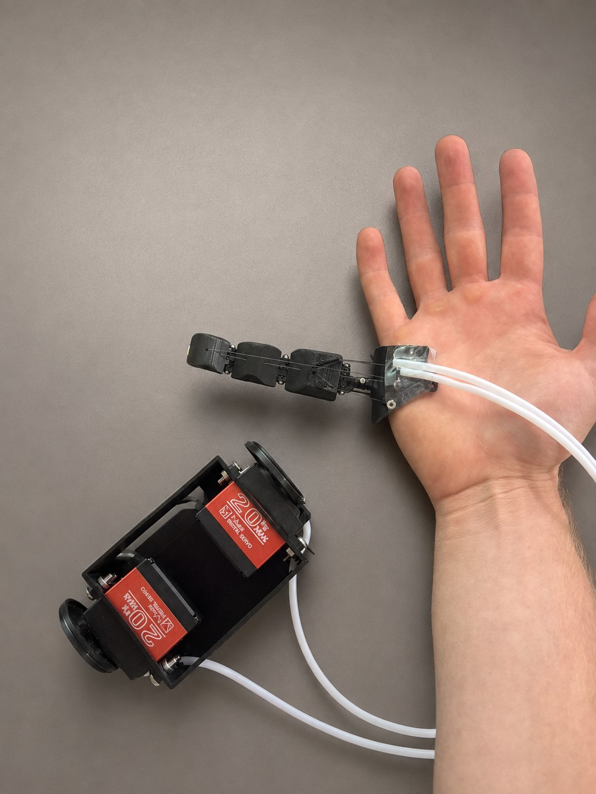
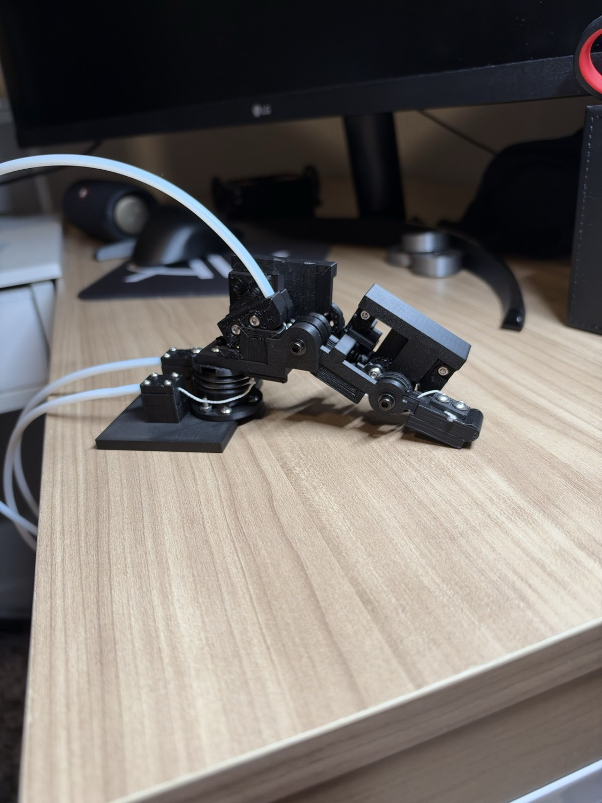
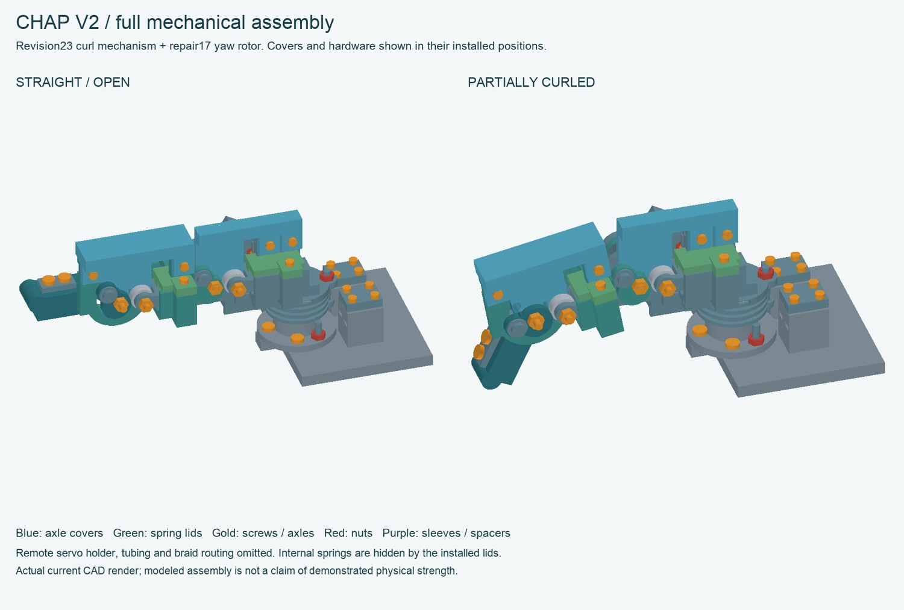

# Tendon-Driven Third Thumb

An independent robotics project by **Noah Wilson**. I built a wearable, cable-driven extra digit, then redesigned the mechanism around separate yaw and curl after the first prototype exposed a lateral actuation problem.

| V1 · Wearable prototype | V2 · Bench mechanism |
| --- | --- |
|  |  |
| [Wearable close-up](v1-wearable.jpg) · [Photo walkthrough (MP4)](v1-photo-walkthrough.mp4) · [SolidWorks CAD (ZIP)](v1-solidworks-cad.zip) | [Spring-return demo (MP4)](v2-manual-spring-return.mp4) · [STEP CAD (ZIP)](v2-step-cad.zip) · [Assembly render](v2-assembly-cad.jpg) |

## V1 — Wearable prototype

I adapted an existing printed linkage to my hardware, integrated two remote servos and an ESP32, and built and tested the Bowden tendon transmission. The prototype closed inward. The lateral joint could move mechanically, but its tendon routing did not produce reliable motor-driven side-to-side motion. The digit also tended to fold near the base before reaching the middle of the palm.

The CAD archive contains my two installed hardware-fit edits alongside the earlier reference assembly. That assembly still shows the earlier parts. The [V1 video](v1-photo-walkthrough.mp4) is a captioned photo walkthrough.

## V2 — Separate yaw and curl

I moved the redesign to a bench fixture so I could assemble and test the mechanism independently of a wearable mount. Two opposing yaw tendons wrap around a bearing-supported rotor. A separate curl tendon passes through a root idler and anchors on the tip link. Roller followers and compression springs provide the return motion. Open pivots with bolt-on axle covers let the links assemble without forcing the shafts into closed sockets.

The [manual bench video](v2-manual-spring-return.mp4) shows the isolated short-spring return fixture moving and reopening after release. The [assembly photos](#v2-assembly-photos) show the later integrated mechanism. Powered full-assembly motion, grasp load, and wearable operation still need validation. EMG and tactile sensing remain future work.

### What changed and why

| Observation | Design response |
| --- | --- |
| V1 closed inward but produced little useful motor-driven lateral motion. | Separate yaw from curl. Opposing yaw tendons act on their own rotor, while a third tendon curls the links. |
| The V1 elastic return lost tension near full closure. | Try a guided compression spring and roller cam. The isolated fixture returned by hand with the shorter spring. |
| Printed yaw shafts broke during assembly. | Add an M3 steel through-core and revise the rotor so the clamp nuts can still seat. |
| Thin printed features broke during support removal or assembly. | Thicken the connections, change support placement, and use removable covers to assemble the pivots. |

CAD checks examined interference at sampled poses and whether parts could be inserted in sequence. Physical strength and service life remain unmeasured.

[Yaw tendon routing](v2-yaw-tendon-routing.jpg) · [Curl tendon routing](v2-curl-tendon-routing.jpg) · [Spring-return fixture photo](v2-return-fixture.jpg) · [CAD and attribution notes](CAD.md)

## V2 assembly photos

[01](v2-assembly-01.jpg) · [02](v2-assembly-02.jpg) · [03](v2-assembly-03.jpg) · [04](v2-assembly-04.jpg) · [05](v2-assembly-05.jpg) · [06](v2-assembly-06.jpg)

## Credits

Noah Wilson built, assembled, and tested the prototypes. V1 builds on the MIT-licensed [Third Thumb Project by laxmangordon](https://github.com/laxmangordon/Third-Thumb-Project). V2 CAD and analysis were developed with AI assistance.
